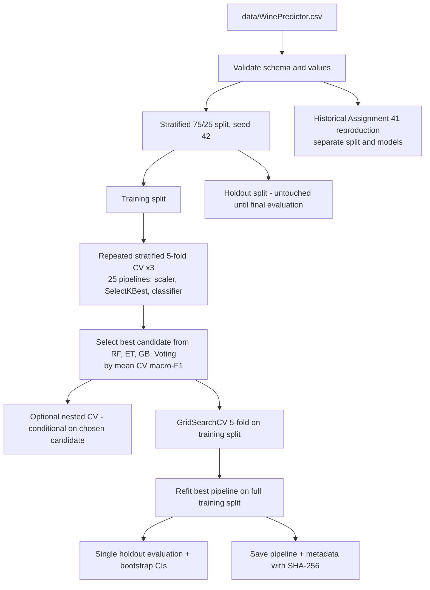

# Wine Classification Using Ensemble Learning and Robust Model Evaluation

Multiclass classification of wine cultivars from 13 chemical measurements, built as an end-to-end, leakage-aware machine learning workflow: validated data loading, in-pipeline feature selection, repeated stratified cross-validation across baseline, single-model and ensemble candidates, hyperparameter tuning, a one-time holdout evaluation with bootstrap intervals, reproduction of earlier assignment experiments, model persistence with integrity checks, and an interactive Streamlit dashboard.

**Author:** Vivaan Kukreja
**Repository:** `wine-quality-classification-ensemble-learning`

---

## Table of Contents

1. [Project Overview](#1-project-overview)
2. [Problem Statement and Objectives](#2-problem-statement-and-objectives)
3. [Dataset](#3-dataset)
4. [Preprocessing and Exploratory Data Analysis](#4-preprocessing-and-exploratory-data-analysis)
5. [Feature Selection Methodology](#5-feature-selection-methodology)
6. [Models and Ensemble Learning](#6-models-and-ensemble-learning)
7. [Training, Cross-Validation and Tuning](#7-training-cross-validation-and-tuning)
8. [Evaluation Metrics](#8-evaluation-metrics)
9. [Historical Experiment Reproduction](#9-historical-experiment-reproduction)
10. [Robustness and Statistical Analysis](#10-robustness-and-statistical-analysis)
11. [Model Persistence and Inference](#11-model-persistence-and-inference)
12. [Streamlit Dashboard](#12-streamlit-dashboard)
13. [Project Architecture](#13-project-architecture)
14. [Installation and Setup](#14-installation-and-setup)
15. [Running the Project](#15-running-the-project)
16. [Running Automated Tests](#16-running-automated-tests)
17. [Expected Outputs](#17-expected-outputs)
18. [Technical Stack](#18-technical-stack)
19. [Key Findings and Limitations](#19-key-findings-and-limitations)
20. [Future Improvements](#20-future-improvements)
21. [Author](#21-author)

---

## 1. Project Overview

This repository contains two clearly separated analyses of the same dataset:

| Workflow | Purpose | Split | Where it lives |
|---|---|---|---|
| **Modern evaluation workflow** | Compare models and feature counts, tune the chosen model and estimate its generalisation on an untouched holdout set | Stratified 75% / 25% | `model_training.py`, `evaluation.py`, `feature_selection.py` |
| **Historical reproduction** | Re-run the four original *Assignment 41* Random Forest experiments and measure how fragile their single-split accuracies are | Non-stratified 60% / 40% | `historical.py` |

The two workflows use different splits, different models and different feature sets. Their numbers are **not directly comparable** and are reported separately throughout the project.

Everything is orchestrated by `main.py`, configured centrally in `config.py`, and explored interactively through `app.py`.

## 2. Problem Statement and Objectives

**Problem.** Given the chemical analysis of a wine (alcohol, phenols, colour intensity, proline, and others), predict which of three cultivars it was grown from.

**Objectives**

- Build a reproducible multiclass classification pipeline in which preprocessing and feature selection are fitted only on training data.
- Compare a majority-class baseline, Logistic Regression, a Decision Tree and four tree-based or ensemble candidates using repeated stratified cross-validation.
- Compare candidate feature counts (13, 10, 7 and 5) inside the cross-validation loop.
- Tune the selected candidate and evaluate it once on a holdout set that played no role in selection or tuning.
- Report multiclass metrics and bootstrap confidence intervals, and state what those intervals do and do not mean.
- Reproduce the historical Assignment 41 accuracies and quantify their sensitivity to the random split.
- Persist the trained pipeline with metadata and a checksum, and expose it through a dashboard.

## 3. Dataset

**Required input file:** `data/WinePredictor.csv`

The project expects the CSV file at this location. The path is defined centrally in `config.py`, and the dataset is validated by `data_loader.validate_dataset` before the workflow begins.

### Dataset schema

| Property | Description |
|---|---|
| Target column | `Class` |
| Class labels | `1`, `2`, `3` |
| Class names | Cultivar 1, Cultivar 2, Cultivar 3 |
| Input features | 13 numerical chemical measurements |
| Expected columns | `Class` plus the 13 features listed below |
| Additional columns | Not accepted |

### The 13 input features

The model expects these exact feature names and uses their configured order:

| No. | Feature |
|---:|---|
| 1 | Alcohol |
| 2 | Malic acid |
| 3 | Ash |
| 4 | Alcalinity of ash |
| 5 | Magnesium |
| 6 | Total phenols |
| 7 | Flavanoids |
| 8 | Nonflavanoid phenols |
| 9 | Proanthocyanins |
| 10 | Color intensity |
| 11 | Hue |
| 12 | OD280/OD315 of diluted wines |
| 13 | Proline |

**Dataset origin and reference.** The feature schema corresponds to the widely used UCI Wine Recognition dataset, which is also available through scikit-learn's `load_wine()` utility. The automated test suite uses scikit-learn's bundled dataset to test the project independently of the external CSV file.

**Repository dataset status.** The supplied project archive includes `WinePredictor.csv` in the project root directory rather than inside `data/`. Before running the application, move the file into the configured dataset location:

```text
data/WinePredictor.csv
```

The expected directory structure is documented in Section 13. The application reads the dataset from the path configured in `config.py`.

### Reference statistics

The following values describe the standard scikit-learn Wine dataset. They are reference statistics, not independently verified statistics for the external `WinePredictor.csv` file.

| Property | Standard Wine dataset |
|---|---:|
| Observations | 178 |
| Class 1 | 59 |
| Class 2 | 71 |
| Class 3 | 48 |
| Missing values | 0 |
| Duplicate rows | 0 |

When the supplied CSV is available, the actual dataset shape, class distribution, missing values, duplicate counts and feature statistics are calculated by the pipeline and saved to `outputs/reports/dataset_summary.json`.

### Validation rules

The data loader checks:

- The dataset is non-empty.
- Column names are unique.
- The column set matches the expected target and 13 feature names exactly.
- Feature columns have numeric, non-boolean data types.
- No missing or non-finite numerical values are present.
- Class labels belong to the expected set `{1, 2, 3}`.
- All three classes are represented.

A dataset that does not satisfy these checks is rejected before model training.

## 4. Preprocessing and Exploratory Data Analysis

### Preprocessing

- **Scaling:** `StandardScaler` is the first step of every modelling pipeline, so it is fitted on training folds only.
- **Splitting:** a stratified train/holdout split (`test_size=0.25`, `random_state=42`). With the 178-row standard dataset this yields 133 training and 45 holdout rows.
- **No row removal:** IQR outlier counts are computed per feature for description only; no observations are dropped.

### Exploratory analysis

`main.py` generates descriptive statistics (`dataset_summary.json`) and the following figures:

| Figure | Content |
|---|---|
| `class_distribution.png` | Class balance |
| `feature_histograms.png` | Distribution of each feature |
| `feature_boxplots.png` | Class-wise boxplots |
| `class_mean_heatmap.png` | Class-wise standardised feature means |
| `correlation_heatmap.png` | Feature correlation matrix |
| `top_feature_scatter.png` | Scatter of the two highest-ranked training features |

EDA figures are descriptive. The scatter plot and the feature ranking use the **training split only**.

## 5. Feature Selection Methodology

Three distinct mechanisms exist in this project. They answer different questions and must not be conflated.

| Mechanism | Where | Data used | Role |
|---|---|---|---|
| **Historical feature sets** | `config.HISTORICAL_FEATURE_SETS` | Fixed lists carried over from Assignment 41 | Reproduction only. The code does not record how these subsets were derived. |
| **In-pipeline selection** | `SelectKBest(f_classif, k)` as the second pipeline step | Refitted on the training portion of every CV fold and tuning fold | The selection that actually determines the final model. |
| **Training-only feature ranking** | `feature_selection.rank_features` | Training split only | Interpretation and reporting (`feature_ranking.csv`, `feature_ranking.png`). Does not choose features for the model. |

**In-pipeline selection.** `k` takes the values 13, 10, 7 and 5 (`config.FEATURE_COUNTS`). Because the selector sits inside the scikit-learn `Pipeline`, ANOVA F-scores are recomputed within each training fold. Selection therefore never sees the validation fold or the holdout set during cross-validation or tuning.

**Training-only ranking.** `rank_features` reports, for each feature, the ANOVA F-statistic and p-value and the importance from a 500-tree Random Forest, with ranks for both. The table is sorted by Random Forest rank.

**What is and is not claimed.** The modern workflow does not use the holdout set for feature selection. The *choice of candidate* (family and `k`) is made on the same training data used for tuning, so cross-validation scores used for selection are optimistically biased. Nested cross-validation (Section 10) addresses only part of that. The historical feature subsets carry no leakage-free claim (Section 9).

## 6. Models and Ensemble Learning

All candidates are built by `model_training.build_estimator` and wrapped as `StandardScaler -> SelectKBest -> classifier`.

| Family key | Model | Role |
|---|---|---|
| `dummy_majority` | `DummyClassifier(strategy="prior")` | Baseline; evaluated with all 13 features only |
| `logistic_regression` | Logistic Regression (`max_iter=2000`) | Interpretable linear reference |
| `decision_tree` | Decision Tree | Single-tree reference |
| `random_forest` | Random Forest (300 trees) | Bagged trees; selection candidate |
| `extra_trees` | Extra Trees (300 trees) | Randomised bagged trees; selection candidate |
| `gradient_boosting` | Gradient Boosting | Sequential boosted trees; selection candidate |
| `voting_ensemble` | Soft Voting of Logistic Regression + Random Forest + Extra Trees | Heterogeneous ensemble; selection candidate |

The baseline, Logistic Regression and Decision Tree are **reference models** that appear in the comparison table but are **not eligible** for selection (`config.SELECTION_FAMILIES` contains only the four tree-based or ensemble families).

### Ensemble methodology

- **Random Forest / Extra Trees:** averaging of many decorrelated decision trees (bagging; Extra Trees additionally randomises split thresholds).
- **Gradient Boosting:** trees fitted sequentially to correct earlier errors.
- **Soft voting:** averages predicted class probabilities from a linear model and two tree ensembles, combining different inductive biases.

A random seed of 42 is used for all estimators.

## 7. Training, Cross-Validation and Tuning



### Candidate comparison

`run_cv_comparison` evaluates **25 pipelines**: the baseline (13 features) plus six model families, each at 13, 10, 7 and 5 features. It uses `RepeatedStratifiedKFold` with 5 splits and 3 repeats (15 folds per candidate, `random_state=42`) on the **training split only**. Six metrics are recorded per candidate as mean and sample standard deviation (`ddof=1`).

### Candidate selection

`select_best_candidate` considers only the selection families and ranks them by mean CV macro-F1 (the primary metric). Ties are broken by fewer features, then by lower model complexity (`config.FAMILY_COMPLEXITY`). The raw best candidate is also recorded alongside the chosen one.

### Hyperparameter tuning

`tune_pipeline` runs `GridSearchCV` on the selected candidate with a shuffled `StratifiedKFold` (5 splits, `random_state=43`), scoring by macro-F1, and refits the best pipeline on the full training split. Grids (`config.PARAM_GRIDS`):

| Family | Grid |
|---|---|
| Random Forest | `n_estimators` {100, 300}, `max_depth` {None, 5}, `min_samples_leaf` {1, 2} |
| Extra Trees | `n_estimators` {100, 300}, `max_depth` {None, 5}, `min_samples_leaf` {1, 2} |
| Gradient Boosting | `n_estimators` {50, 100, 200}, `learning_rate` {0.05, 0.1}, `max_depth` {1, 2, 3} |
| Soft Voting | Logistic Regression `C` {0.1, 1.0, 10.0} |

The feature count `k` is fixed by the selection step and is not part of the tuning grid. Only the selected family is tuned, not every candidate.

## 8. Evaluation Metrics

| Metric | Role in this project |
|---|---|
| **Accuracy** | Overall fraction of correct predictions. Easy to read, but insensitive to per-class behaviour. |
| **Macro precision** | Mean per-class precision with equal class weight. |
| **Macro recall** | Mean per-class recall with equal class weight. |
| **Macro F1** | **Primary metric** for selection and tuning. Gives each cultivar equal weight despite imbalance (about 59/71/48). |
| **Weighted F1** | F1 averaged by class support; reflects overall performance on the actual class mix. |
| **ROC-AUC (one-vs-rest, macro)** | Ranking quality from predicted probabilities. Computed in cross-validation and on the holdout set when valid probabilities are available. |
| **Confusion matrix** | Class-by-class error pattern on the holdout set (`holdout_confusion_matrix.png`). |
| **Classification report** | Per-class precision, recall, F1 and support (`classification_report.csv`). |
| **Bootstrap confidence intervals** | 95% percentile intervals for holdout accuracy and macro-F1 (Section 10). |

All metrics use `zero_division=0` and an explicit label list so that a class missing from predictions does not crash or silently drop out.

> **No performance numbers are quoted in this README.** Final results depend on the dataset file and library versions and are generated when you run `python main.py`. See [Expected Outputs](#17-expected-outputs).

## 9. Historical Experiment Reproduction

`historical.py` re-runs the four Assignment 41 experiments under their original setup:

- Non-stratified `train_test_split`, `test_size=0.4`, `random_state=42`
- `RandomForestClassifier(n_estimators=7, random_state=42)`
- Accuracy as the only metric

| Feature set | Features | Documented historical accuracy |
|---|---:|---:|
| All 13 features | 13 | 97.22% |
| Selected 10 features | 10 | 98.61% |
| Top 7 features | 7 | 94.44% |
| Top 5 features | 5 | 90.28% |

For each experiment, `historical_reproduction.csv` records the reproduced accuracy, the documented accuracy, their difference in percentage points and whether they match within 0.01.

**How to read these numbers**

- **Single split, small test set.** With the standard 178-row dataset, a 40% test split holds 72 observations, so one misclassified sample moves accuracy by about 1.39 percentage points. The gaps between all four feature sets amount to only a few samples.
- **Fixed feature lists.** The Top 7 and Top 5 lists and the 10-feature subset are hard-coded in `config.py`. The repository does not record how they were chosen or on which data. If a subset was chosen with reference to test-set accuracy, its reported accuracy is an optimistically biased estimate and must not be read as an unbiased measure of generalisation. This applies in particular to the 98.61% result for the 10-feature subset.
- **Not comparable to the modern workflow.** Different split, model, seed handling and selection procedure.

The historical results are preserved as a documented reproduction exercise. They are not used to pick the final model.

## 10. Robustness and Statistical Analysis

| Analysis | Implementation | What it tells you | Limitations |
|---|---|---|---|
| **Repeated stratified CV** | 5 folds x 3 repeats, mean and SD per metric | Stability of each candidate across resamples | Folds overlap, so the 15 scores are correlated. The SD is not a proper standard error. Selecting the best of 16 candidates on the same scores inflates the winner's CV score. |
| **Nested CV** (optional) | Outer `StratifiedKFold` (5 splits, seed 44) around the tuning `GridSearchCV` | Estimate of the tuning procedure for the already chosen family and `k` | Conditional on that choice; the code states that it does not evaluate the complete model-selection procedure. |
| **Bootstrap intervals** | 2,000 non-stratified resamples of holdout predictions, seed 42, 2.5th-97.5th percentiles, for accuracy and macro-F1 | Sampling uncertainty of holdout metrics given a fixed fitted model | Holdout is small (45 rows on the standard dataset); intervals can be very narrow or collapse to a point when accuracy is near-perfect, which does not mean certainty. They ignore training-set variability and are not external validation. |
| **Seed sensitivity** (historical) | Seeds 0-49, all four historical feature sets, summarised as mean, SD, min, median, max | How much historical accuracy changes with the random split | Descriptive only; no significance test. The Random Forest seed is held at 42 while the split seed varies. |

No hypothesis tests or formal model-comparison statistics are implemented.

## 11. Model Persistence and Inference

### Model persistence

After hyperparameter tuning and holdout evaluation, `model_training.save_pipeline` saves the fitted pipeline and its metadata.

| File | Description |
|---|---|
| `models/wine_pipeline.joblib` | Fitted scikit-learn preprocessing and classification pipeline |
| `models/model_metadata.json` | Model family, best parameters, feature order, selected features, class labels and names, training feature ranges, split details, random seeds, library versions, creation time, model filename and SHA-256 checksum |

The model and metadata are generated by `main.py` and are excluded from version control through `.gitignore`.

### Inference workflow

The `inference.py` module provides reusable functions for loading the trained model, validating new samples and generating predictions.

- **`load_artifacts`** — loads the saved pipeline and metadata after checking required metadata fields, model filename, feature order, class labels and SHA-256 integrity.
- **`validate_input`** — accepts a dictionary or pandas DataFrame, checks the required 13 input features, validates numeric values and arranges the columns in the configured training order.
- **`detect_out_of_range_features`** — identifies input values outside the minimum and maximum ranges observed during model training.
- **`predict_samples`** — generates class predictions, predicted cultivar names, confidence percentages, per-class probabilities and range warnings for one or more samples.
- **`predict_single`** — provides the single-sample prediction interface.
- **`predict_batch`** — provides the batch prediction interface.

### Feature handling during inference

The saved estimator is a complete scikit-learn pipeline:

`StandardScaler → SelectKBest → Classifier`

All 13 validated input features must be passed to this pipeline. The scaler was fitted before feature selection and therefore expects the complete original feature set. `SelectKBest` performs the configured feature selection internally during prediction.

The input must not be reduced to only the selected features before calling `pipeline.predict()` or `pipeline.predict_proba()`.

### Model integrity and security

The SHA-256 checksum is used to detect changes to the saved model file. Metadata consistency checks help prevent incompatible artifacts from being loaded.

**Security note:** Joblib model files can execute code during loading. Only load model artifacts generated by a trusted source.

## 12. Streamlit Dashboard

The interactive dashboard is implemented in `app.py` and provides six sections through the sidebar.

| Page | Functionality |
|---|---|
| Overview | Project summary, dataset information and data preview |
| Exploratory Analysis | Distribution plots, feature relationships and feature ranking |
| Model Evaluation | Holdout metrics, bootstrap intervals, CV comparison, ROC curves, classification report and nested CV results |
| Historical Analysis | Assignment 41 reproduction results and seed-sensitivity analysis |
| Single Prediction | Enter the 13 chemical measurements and obtain a predicted cultivar with class probabilities |
| Batch Prediction | Upload a CSV containing all 13 required feature columns, generate predictions and download the results |

### Dashboard requirements

The dashboard depends on generated artifacts:

- The dataset CSV must be available at `data/WinePredictor.csv`.
- Run `python main.py` to generate the reports, figures, saved model and metadata.
- The evaluation and historical analysis pages use generated files from `outputs/`.
- The prediction pages require the saved model and metadata in `models/`.

The prediction interface passes all 13 validated features to the saved pipeline. Feature selection is performed internally by the pipeline.

The sidebar displays the saved model family and selected feature count when valid model artifacts are available.

## 13. Project Architecture

```
wine-quality-classification-ensemble-learning/
├── app.py                  # Streamlit dashboard
├── main.py                 # End-to-end workflow entry point
├── config.py               # Paths, seeds, CV settings, grids, historical settings
├── data_loader.py          # Reading, validation, splitting, dataset summary
├── feature_selection.py    # SelectKBest builder, selected-feature recovery, training-only ranking
├── model_training.py       # Pipelines, CV comparison, selection, tuning, nested CV, persistence
├── evaluation.py           # Metrics, holdout evaluation, bootstrap CIs, JSON/CSV writers
├── visualization.py        # All figures (EDA, ranking, CV, confusion matrix, ROC, historical)
├── historical.py           # Assignment 41 reproduction and seed sensitivity
├── inference.py            # Artifact loading and checks, input validation, prediction
├── test_project.py         # pytest suite
├── requirements.txt
├── .gitignore
├── README.md
├── data/
│   └── WinePredictor.csv   # Required input (not generated)
├── models/                 # Generated: wine_pipeline.joblib, model_metadata.json
└── outputs/
    ├── figures/            # Generated PNG figures
    └── reports/            # Generated CSV and JSON reports
```

All modules sit at the repository root and import each other directly, so run commands from the root.

| Module | Responsibility |
|---|---|
| `config.py` | Single source of truth for paths, column names, seeds, split sizes, CV settings, candidate lists, tuning grids and historical settings. |
| `data_loader.py` | Reads and validates the CSV, separates features and target, creates the stratified split and computes dataset quality statistics. |
| `feature_selection.py` | Builds the `SelectKBest` selector, recovers selected feature names from a fitted pipeline and computes the training-only ANOVA and Random Forest ranking. |
| `model_training.py` | Defines estimators and pipelines, runs the CV comparison and candidate selection, tuning, nested CV, metadata construction and model saving. |
| `evaluation.py` | Computes multiclass metrics and holdout results, bootstrap intervals, and writes JSON and CSV reports. |
| `visualization.py` | Produces all figures saved to `outputs/figures/`. |
| `historical.py` | Reproduces the four historical experiments and runs seed-sensitivity analysis. |
| `inference.py` | Loads and verifies saved artifacts, validates inputs and generates predictions with range warnings. |
| `main.py` | Runs the nine-stage workflow and writes all reports, figures and model files. |
| `app.py` | Interactive dashboard over datasets, reports, figures and the saved model. |
| `test_project.py` | Unit and integration tests. |

## 14. Installation and Setup

**Prerequisites:** Python 3 and `pip`.

Dependencies in `requirements.txt` are currently unpinned, so exact behaviour may vary across library versions.

### 1. Clone the repository

```bash
git clone https://github.com/Vivk1560/wine-quality-classification-ensemble-learning.git
cd wine-quality-classification-ensemble-learning
```

### 2. Create and activate a virtual environment

```bash
python -m venv .venv
```

**Windows:**

```powershell
.venv\Scripts\activate
```

**Linux / macOS:**

```bash
source .venv/bin/activate
```

### 3. Install dependencies

```bash
pip install -r requirements.txt
```

The requirements file includes:

- numpy
- pandas
- scikit-learn
- matplotlib
- seaborn
- joblib
- streamlit
- pytest

### 4. Provide the dataset

The supplied project archive includes `WinePredictor.csv` in its root directory. The application expects the dataset inside the `data/` directory.

After extracting the project archive, open a terminal in the project root and execute the appropriate commands.

**Windows PowerShell:**

```powershell
New-Item -ItemType Directory -Force -Path data
Move-Item .\WinePredictor.csv .\data\WinePredictor.csv
```

**Linux / macOS:**

```bash
mkdir -p data
mv WinePredictor.csv data/WinePredictor.csv
```

Verify that the dataset is available at:

```text
data/WinePredictor.csv
```

The automated tests use scikit-learn's bundled Wine dataset and do not require the external CSV file.

## 15. Running the Project

**Full workflow**

```bash
python main.py
```

**Optional flags** (the only two flags implemented)

```bash
python main.py --skip-nested-cv           # skip the nested CV estimate
python main.py --skip-seed-sensitivity    # skip the 50-seed historical analysis
```

`main.py` runs nine stages: dataset validation and summary; EDA figures; training-only feature ranking; repeated-CV model comparison; nested CV; tuning; holdout evaluation with bootstrap intervals; historical reproduction and seed sensitivity; run summary. It also saves the model between stages 7 and 8.

**Dashboard**

```bash
streamlit run app.py
```

## 16. Running Automated Tests

```bash
python -m pytest test_project.py -v
```

The suite uses scikit-learn's bundled Wine dataset rather than `data/WinePredictor.csv`, so it does not depend on your CSV. It covers dataset validation, feature/target separation, stratified splitting, the feature selector and ranking, estimator and pipeline construction, candidate selection, metrics, holdout evaluation, bootstrap intervals, historical reproduction, seed sensitivity, input validation, out-of-range detection and prediction.

## 17. Expected Outputs

Running `python main.py` creates the following. No result values are listed here because they are produced by your run.

**Models (`models/`)**

- `wine_pipeline.joblib`
- `model_metadata.json`

**Reports (`outputs/reports/`)**

| File | Content |
|---|---|
| `dataset_summary.json` | Shape, class counts and percentages, missing and duplicate counts, IQR outlier counts, feature statistics |
| `feature_ranking.csv` | ANOVA and Random Forest ranking (training split) |
| `cv_comparison.csv` | Mean and SD of six metrics for all 25 candidates |
| `nested_cv_estimate.json` | Nested CV macro-F1 and accuracy (unless skipped) |
| `holdout_evaluation.json` | Holdout metrics, confusion matrix, predictions and probabilities |
| `classification_report.csv` | Per-class holdout report |
| `bootstrap_confidence_intervals.json` | 95% bootstrap intervals |
| `final_metrics.json` | Holdout metrics and intervals in one file |
| `historical_reproduction.csv` | Reproduced versus documented historical accuracy |
| `seed_sensitivity.csv`, `seed_sensitivity_summary.csv` | Per-seed and summarised historical accuracy (unless skipped) |
| `run_summary.json` | Consolidated record of the whole run |

**Figures (`outputs/figures/`)**

`class_distribution.png`, `feature_histograms.png`, `feature_boxplots.png`, `class_mean_heatmap.png`, `correlation_heatmap.png`, `feature_ranking.png`, `top_feature_scatter.png`, `cv_comparison.png`, `holdout_confusion_matrix.png`, `holdout_roc_curves.png`, `historical_comparison.png`

Generated models, reports and figures are excluded from version control through `.gitignore`. The required output directories are created by the application when the workflow runs; `.gitkeep` placeholder files are not required in the supplied project structure.

## 18. Technical Stack

| Area | Tools |
|---|---|
| Language | Python |
| Data | pandas, NumPy |
| Machine learning | scikit-learn (Pipeline, StandardScaler, SelectKBest, Random Forest, Extra Trees, Gradient Boosting, Logistic Regression, Decision Tree, VotingClassifier, GridSearchCV, RepeatedStratifiedKFold) |
| Visualisation | Matplotlib, seaborn |
| Persistence | joblib, JSON |
| Dashboard | Streamlit |
| Testing | pytest |

## 19. Key Findings and Limitations

This section deliberately contains no headline accuracy claim. The checked-in code does not contain results, and the numbers you obtain should be read from `outputs/reports/`.

**Design strengths**

- Scaling and feature selection are inside the pipeline, so cross-validation and tuning do not see validation data during fitting.
- The holdout set is used once, after selection and tuning.
- Candidate comparison includes a majority-class baseline and simpler models, so ensemble gains can be judged against something.
- Historical and modern results are kept separate and labelled.
- Saved models are verified against metadata and a checksum before use.

**Limitations**

- **Small dataset.** With 178 observations, the holdout set has only 45 rows. Holdout metrics and bootstrap intervals have limited resolution, and near-perfect scores are common on this well-studied dataset. Do not read them as evidence of real-world performance.
- **Selection optimism.** Candidates are chosen by CV on the same data used for tuning. Nested CV is conditional on the choice and does not quantify selection bias.
- **Correlated CV scores.** Repeated-CV standard deviations understate uncertainty.
- **Single holdout split.** Results depend on one random partition (seed 42).
- **Historical results.** Based on one non-stratified split with a 72-row test set and hard-coded feature subsets of undocumented origin. The 10-feature result in particular is not an unbiased generalisation estimate.
- **Scope.** One dataset of 178 wines from a single region and study. The model is not validated for other wines, instruments or populations, and out-of-range warnings are simple min-max checks.
- **Unpinned dependencies.** Results and behaviour can shift across library versions.
- **External dataset location.** The supplied project archive includes `WinePredictor.csv` in its root directory. It must be moved to `data/WinePredictor.csv` before running the main workflow or dataset-dependent dashboard pages. Reference statistics for the standard scikit-learn Wine dataset should not be interpreted as verified statistics for the external CSV.
- **Inference input contract.** The trained pipeline expects all 13 original features in the configured order. The scaler and feature selector are applied inside the saved pipeline; callers should not pre-select columns before prediction.
- **Training-range warnings.** Out-of-range detection compares input values with the minimum and maximum values observed in the training data. It is a warning mechanism, not a guarantee that an input is invalid or that an in-range sample is reliable.

## 20. Future Improvements

- Pin dependency versions and add a Python version constraint.
- Evaluate the complete selection-plus-tuning procedure with fully nested cross-validation.
- Add repeated holdout or repeated outer CV to reduce dependence on one split.
- Add paired statistical comparison between candidate models.
- Add probability calibration analysis and per-class error analysis.
- Add continuous-integration test runs.
- Add Dockerisation or hosted dashboard deployment.

## 21. Author

**Vivaan Kukreja**
B.Tech Information Technology